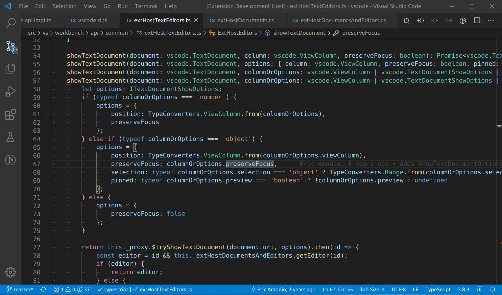

## *This project is in maintenance mode.  It does everything I need.  I will accept PRs for small new features, but I won't be adding any new features myself.  The readme contains full instructions on how to publish.  Feel free to fork and publish what every fancy or specific changes you want.

# Auto Hide

Extension install pages:

* VS Code Marketplace: <https://marketplace.visualstudio.com/items?itemName=sirmspencer.vscode-autohide>
* Open VSX (VSCodium and other open source builds): <https://open-vsx.org/extension/sirmspencer/vscode-autohide>

Requires VS Code 1.74 or later.

## Features

### Auto-hide side bar

Causes the side bar to be hidden whenever the user clicks into the text editor.

I highly recommend trying the sidebar on the right side.  The side bar does not so when on the left, the editor text will shift when the side panel opening and closing.



### Auto-hide bottom panel

Same thing as above, except for the bottom panel (output, terminal, etc. are contained in the panel). Clicks inside the Output panel do not hide it.

### Auto-hide auxiliary bar

Same thing as above, for the auxiliary bar (the second side bar).

### Auto-hide References panel

Optionally closes the References panel opened by `Go to References`. This is disabled by default; see `autoHide.autoHideReferences` below.

## Settings

* `autoHide.autoHideSideBar`: Hide the side bar when the user clicks into a text editor. [boolean, default: `true`]
* `autoHide.autoHideAuxiliaryBar`: Hide the auxiliary bar (second side bar) when the user clicks into a text editor. [boolean, default: `true`]
* `autoHide.autoHidePanel`: Hide the panel (output, terminal, etc.) when the user clicks into a text editor. [boolean, default: `true`]
* `autoHide.autoHideReferences`: Hide the References panel (`Go to References`) when the user clicks into a text editor. Clicking inside the References panel also counts as a click into a text editor, which closes the panel while it is being used. [boolean, default: `false`]
* `autoHide.keepSideBarWhileDebugging`: Do not hide the side bar while a debug session is running. [boolean, default: `false`]
* `autoHide.hideOnOpen`: When VS Code first opens, hide each part whose auto-hide setting is enabled. [boolean, default: `false`]

## Commands

* `autoHide.toggleHideSideBar`: Toggle `autoHide.autoHideSideBar` setting for current workspace. Use this command to pin/unpin the side bar.
* `autoHide.toggleHideAuxiliaryBar`: Toggle `autoHide.autoHideAuxiliaryBar` setting for current workspace. Use this command to pin/unpin the auxiliary bar.
* `autoHide.toggleHidePanel`: Toggle `autoHide.autoHidePanel` setting for current workspace. Use this command to pin/unpin the panel.

## Tips

### Hide the terminal with Escape

The extension does not bind any keys. To close the panel by pressing Escape while the terminal has focus, add the following to `keybindings.json`. Programs running in the terminal will no longer receive the Escape key.

```json
{
    "key": "escape",
    "command": "workbench.action.closePanel",
    "when": "terminalFocus"
}
```

## Developing

*Developing and Publishing sections updated with LLM assistance*

1) Clone the repo: <https://github.com/sirmspencer/vscode-autohide.git>
2) Run `npm install`.
3) Make code changes in the `src` folder.
4) Run `npm run compile` to start the compiler in watch mode. In VS Code, Ctrl+Shift+B also works.
5) Run `npm test` to compile and run the unit tests.
6) In VS Code, open the Run and Debug panel and launch the extension from there.

## Publishing

The extension is published to two registries. VS Code uses the Visual Studio Marketplace. VSCodium and other open source builds use Open VSX.

### Release

Publishing is done by the `release` GitHub Actions workflow (`.github/workflows/release.yml`), which runs when a `v*` tag is pushed.

1) Bump `version` in `package.json` and add a `CHANGELOG.md` entry.
2) Commit and push to master.
3) Tag the commit with the same version and push the tag:

```sh
git tag v1.2.3
git push origin v1.2.3
```

The workflow fails if the tag does not match the `package.json` version. Otherwise it runs the tests, packages the extension, attaches the `.vsix` to a GitHub release, and publishes it to both registries.

### Repository secrets

The workflow reads two repository secrets:

* `VSCE_PAT`: an Azure DevOps (<https://dev.azure.com/>) personal access token with the Marketplace "Manage" scope.
* `OVSX_PAT`: an Open VSX (<https://open-vsx.org>) access token for the `sirmspencer` namespace.

### Publishing manually

With `VSCE_PAT` and `OVSX_PAT` set in the environment:

```sh
npm run package
npx vsce publish --packagePath vscode-autohide-<version>.vsix
npx ovsx publish vscode-autohide-<version>.vsix
```

<https://code.visualstudio.com/api/working-with-extensions/publishing-extension>

<https://github.com/eclipse/openvsx/wiki/Publishing-Extensions>

## Credit to 'VTools for Visual Studio Code'

This extension is a heavily modified version of:
<https://marketplace.visualstudio.com/items?itemName=venryx.vscode-vtools>
